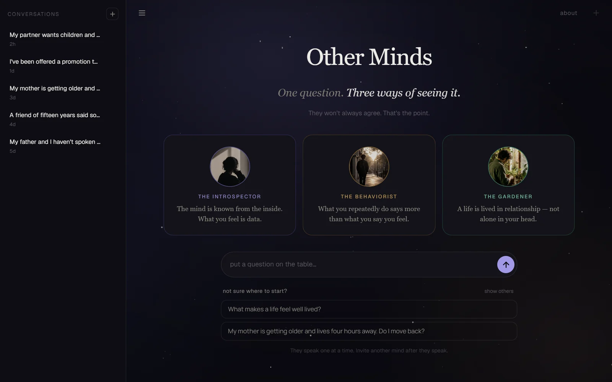
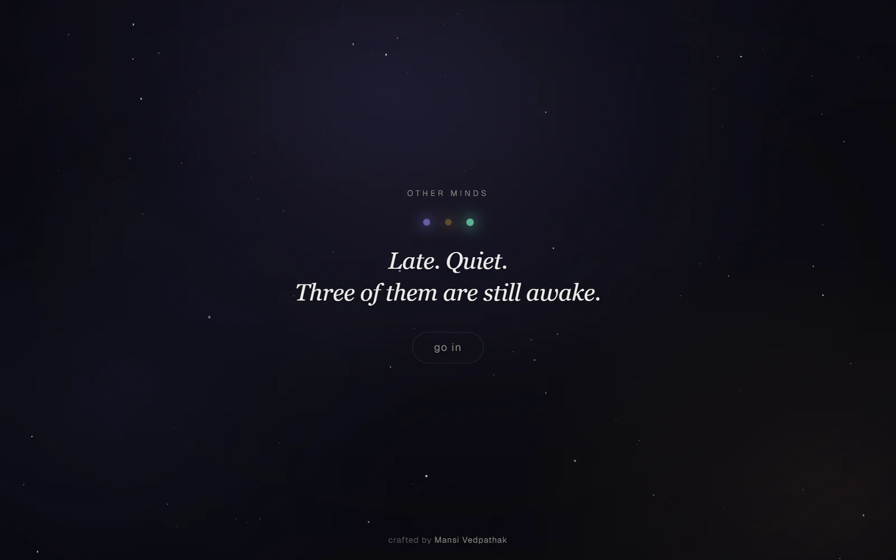
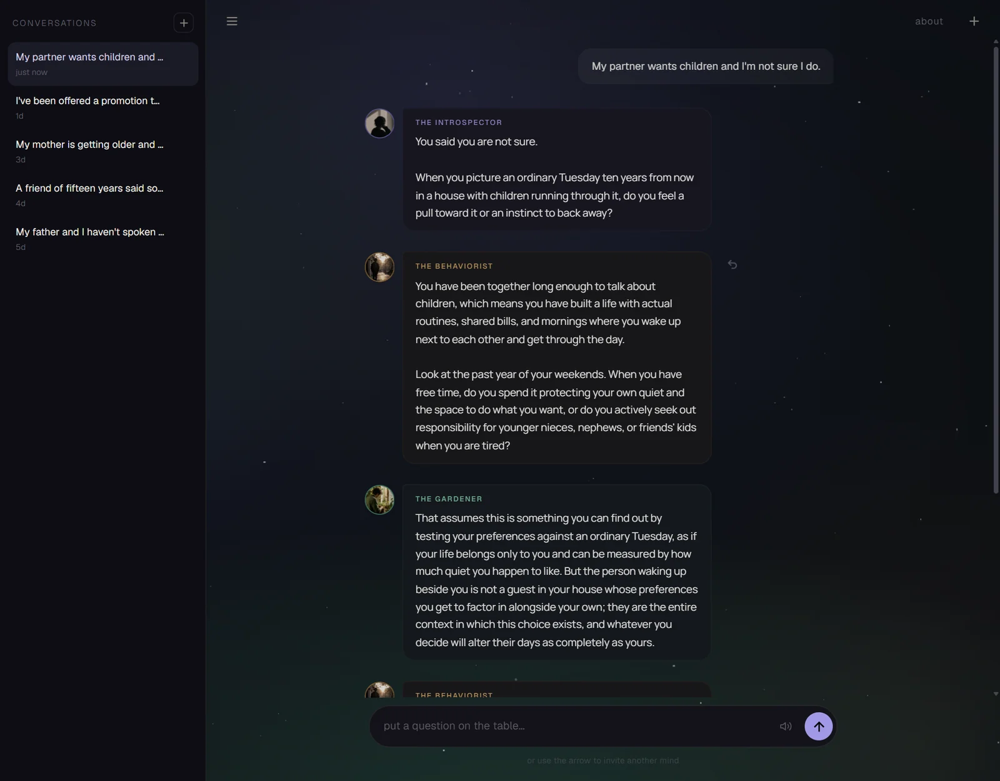
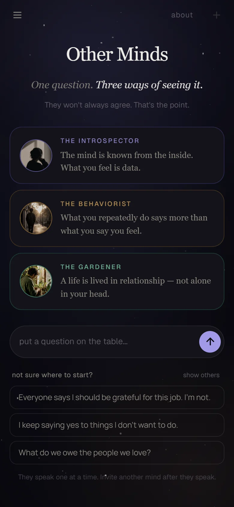
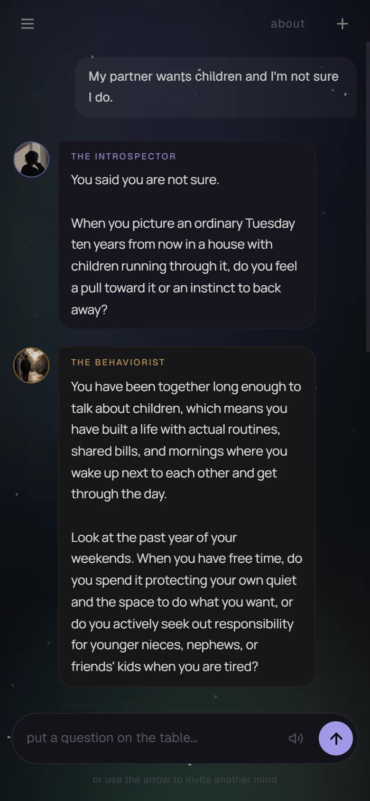

<h1 align="center">Other Minds</h1>

<p align="center"><em>One question. Three ways of seeing it.</em><br>
They won't always agree. That's the point.</p>

<p align="center">
  
</p>

> You ask an AI. It agrees with you.

That's the failure mode this project exists to avoid. A single chatbot mirrors
whatever frame you walk in with: it anchors, it flatters, it reaches for
consensus. Other Minds refuses to converge. Three agents, **the Introspector**,
**the Behaviorist** and **the Gardener**, read the same question through
genuinely different lenses: what you feel, what you repeatedly do, what you've
already said to other people. They are not trying to agree with you, or with each
other. The point is the perspective shift, not a resolution.

## A look around

<table>
  <tr>
    <td width="50%"></td>
    <td width="50%"></td>
  </tr>
  <tr>
    <td align="center"><sub><b>The door.</b> Shown once, to a first-time visitor. An "about" link brings it back.</sub></td>
    <td align="center"><sub><b>The room.</b> One message at a time, each mind in its own colour. The reply arrow appears on hover.</sub></td>
  </tr>
</table>

<table>
  <tr>
    <td width="33%"></td>
    <td width="33%"></td>
    <td width="33%"></td>
  </tr>
  <tr>
    <td align="center"><sub>The door</sub></td>
    <td align="center"><sub>The landing</sub></td>
    <td align="center"><sub>A conversation</sub></td>
  </tr>
</table>

<sub>The conversations in these screenshots are sample ones from the repository's seeded corpus: real replies from the model, to made-up questions.</sub>

## How a conversation works

You are never bombarded. Nothing auto-advances, and who you hear next is always
your call.

| You want to… | Do this |
|---|---|
| Start with an idea | Pick one of the three starting questions under the box (**show others** reshuffles them). Choosing one fills the box; it doesn't send. |
| Ask something | Type it and press enter. **One** mind answers, chosen at random. |
| Hear someone else | Press **hear another mind**, or send an empty box with the arrow. The next voice is always a different one. |
| Hear a particular mind | **Say its name.** "Gardener, what do you think?" gives you the Gardener. Naming two minds is treated as a topic, not a request. |
| Answer one mind directly | **Swipe a message to the right** (touch), or use the reply arrow that appears beside it (mouse and keyboard). Your next message goes to *that* mind, with the line you're answering quoted. Escape cancels. |
| Retry a failed turn | **try again** returns to the same mind that was about to speak, rather than drawing a new one. |
| Come back to it later | Conversations are kept in the sidebar, stored by the service, not in your browser. |

The minds also talk to each other. When one names another, that mind is pulled
forward in the next draw (roughly 70% against 50% otherwise), and the pull stands
down after four turns between the same two so the third is never shut out. The
draw itself is untouched: the rule lives in one place,
[`backend/app/orchestrator.py`](backend/app/orchestrator.py).

## The problem it's actually testing

Multi-agent LLM systems are a well-studied idea, but almost all of that work
optimizes for *agreement*: debate until the agents converge, refine until the
output is more accurate. That's a different goal from this one. Other Minds
doesn't ask the agents to settle anything. It asks whether giving someone three
deliberately distinct readings of their own situation measurably widens how they
think about it, and whether an LLM can actually sustain three distinct voices
long enough for that to matter, instead of quietly collapsing into one helpful
tone wearing three name tags.

That second question turns out to be the harder one to even ask honestly, which
is most of what makes this project worth a second look.

## Keeping the agents honest

Any of the three lenses can state a guess about your inner life as though it were
settled fact. The Introspector: *"you already know you want to leave."* The
Behaviorist: *"you're avoiding the decision because you're afraid of what happens
next."* The Gardener: *"you don't want to disappoint your partner."* Different
lenses, the same failure: a reading presented as a fact no one outside you could
actually check.

The fix isn't a list of banned phrases; banning "you already know" would also
block the same sentence when it's honestly owned. So the house rule,
**hypothesis is not fact**, applies to all three agents at once, underneath
whatever each one individually notices, and a detector in
[`backend/app/epistemics.py`](backend/app/epistemics.py) measures whether it held,
turn by turn, across every stored conversation. It separates a claim about
someone's state into six levels, from *"you said you're afraid"* (reported,
always fine) up through *"the real reason you stayed is fear"* (invented,
flagged), and the same sentence passes or fails depending only on whether it
carries a marker that hands the claim back to the speaker: *"I wonder," "my
read," "might," "seems."* Vocabulary isn't the test; ownership is.

Two sibling rules are measured the same way: an abstract question gets answered
as the question it is, not swapped for an invented personal one, and a lens
stays a lens instead of hardening into an instruction.

It is measurement, not moderation: nothing in the request path calls it, so it
can't stop a bad turn before you see it. What it's for is making the project's
central claim checkable rather than just plausible:

| | result |
|---|---|
| Core specification (100 hand-written cases) | **100/100** pass |
| Adversarial set, written to break it | **16/25** pass, 9 documented gaps |
| This repository's backend test suite | **289 passed** |

The two specification rows come from a written specification of the guardrail
(100 core cases, 25 adversarial ones) that the author keeps with the project's
private notes; it is not in this repository. What *is* here, and re-runnable with
`npm run test:api`, is the test suite, which pins the detector's behaviour with
matched pairs: the same words passing or failing depending only on ownership.

The adversarial number is the more honest one to lead with. Those 9 gaps are
written down in the specification with the exact sentence that slips through and
the exact reason it does: a hedge covering a sentence instead of the clause that needed it, a claim
about a third party where every pattern is anchored to "you." A lexical detector
reading one turn at a time cannot know what you actually said earlier, so it
cannot fully tell a reported fear from an invented one, and the project says so
in its own documentation instead of letting the 100/100 headline do the talking
alone. That's the difference between a feature and an instrument.

## Does it actually work?

The whole app rests on one claim: that these three agents think differently. It
is an easy claim to believe from reading a few transcripts and an easy one to be
wrong about, because prompt edits drift and every agent slowly converges on the
same helpful voice.

So it is measured. `npm run report` trains a cross-validated classifier to guess
which agent wrote a turn, from the text alone:

- near **33%** (chance): one voice in three costumes, whatever the transcripts
  feel like
- clearly above it: the prompts are doing real work, and the confusion matrix
  names which two agents blur together

The same report is served at `/analytics/divergence` and rendered on the
**Divergence** page of the Streamlit UI. Every stored turn is stamped with a
fingerprint of the prompts that produced it, so a prompt change can be judged
against the turns from before it, not against a pool of every version at once.
Details, including why small corpora are refused rather than fudged, are in
[backend/README.md](backend/README.md).

## Quick start

Needs Node and Python 3.12+, and a Gemini API key (free from
[Google AI Studio](https://aistudio.google.com/apikey)).

```bash
git clone https://github.com/imansived/other-minds.git
cd other-minds
npm install
python -m venv backend/.venv
backend/.venv/Scripts/python -m pip install -r backend/requirements-dev.txt   # Windows
# backend/.venv/bin/python -m pip install -r backend/requirements-dev.txt     # macOS/Linux

cp .env.local.example .env.local      # then set GEMINI_API_KEY=your-key
npm run dev:all
```

Open <http://localhost:3000>. The API's interactive docs are at
<http://127.0.0.1:8000/docs>. If the UI says it can't reach the backend, the API
process isn't running: start it with `npm run dev:api`.

`requirements-dev.txt` pulls in the service, the Streamlit UI and the test tools.
To install only what serving needs, use `backend/requirements.txt`.

### With Docker

```bash
cp .env.local.example .env.local     # add your GEMINI_API_KEY
docker compose up --build
```

| | |
|---|---|
| http://localhost:3000 | the Next.js app |
| http://localhost:8501 | the Streamlit client |
| http://localhost:8000/docs | the API |

Three services from one key. Conversations and the analytics corpus live on a
named volume, so `docker compose down` keeps them; `down -v` is what deletes
them.

<details>
<summary>The deliberate choices in the Docker setup</summary>

In [docker/](docker/) and [docker-compose.yml](docker-compose.yml):

- **Ports are published to `127.0.0.1` only.** Plain `3000:3000` would bind every
  interface and put an app that spends your API quota on the local network.
- **The key is never baked into an image.** It arrives via `env_file` at run time,
  and `.dockerignore` keeps `.env*` out of the build context entirely.
- **Services bind `0.0.0.0` inside containers**, the opposite of the local setup,
  and necessarily so: a container's loopback is its own, so binding it would make
  the service unreachable. The Streamlit image passes `--server.address` on the
  command line to override the loopback pinned in `.streamlit/config.toml`.
- **`web` waits for the API to be healthy**, not merely started, so the first page
  load does not race it.
- The web image uses Next's `output: "standalone"`, and copies `public/` and
  `.next/static` in by hand: standalone omits both, and without them pages render
  while portraits and stylesheets 404.

</details>

## Scripts

| script | does |
|---|---|
| `npm run dev:all` | web + api together |
| `npm run dev` | web only (:3000) |
| `npm run dev:api` | api only (:8000), with reload |
| `npm run dev:ui` | the Streamlit UI (:8501), needs the api running |
| `npm run dev:clean` | free ports 8000/3000 if a previous run left something behind |
| `npm run report` | divergence report: are the agents actually distinct? |
| `npm run seed` | generate a corpus of real agent turns to analyse |
| `npm test` | all tests (backend + UI) |
| `npm run test:api` | backend tests |
| `npm run test:ui` | Streamlit UI tests (headless, API stubbed) |
| `npm run build` | production build of the frontend |

### A note on free-tier quotas

`gemini-3.5-flash` allows roughly **20 requests per day** on the free tier, which
is enough to use the app but not enough to seed a corpus. `npm run seed` therefore
takes `--model`, and the model used is recorded with every turn:

```bash
npm run seed -- --model gemini-3.5-flash-lite --thinking-budget none
```

`--thinking-budget none` is required for the `-lite` models: they reject a budget
of `0` outright, while `gemini-3.5-flash` needs it so thinking tokens do not eat
the output budget. A corpus seeded with one model does not describe another, so
re-seed before comparing numbers across models.

## Architecture

A Python backend does the thinking; a Next.js frontend does the presenting.

```
  browser ──► Next.js  (:3000) ─┐
              proxy route       ├─► FastAPI (:8000) ──► Gemini
  browser ──► Streamlit(:8501) ─┘   agents, prompts,
              direct HTTP           turn logic, LLM call, storage
```

Two frontends, one service. They share no code: the Streamlit app asks the API for
everything, including **who speaks next**. That rule lives in exactly one place
(`backend/app/orchestrator.py`), which is why a second frontend could be added
without it drifting out of step with the first.

The browser never talks to FastAPI directly. The Next.js route handlers under
[`app/api/`](app/api/) proxy to it server-side, so the backend needs no CORS, no
public exposure, and the API key stays out of the client bundle.

| | |
|---|---|
| [`backend/`](backend/) | agents, system prompts, turn logic, model call, storage; see [backend/README.md](backend/README.md) |
| [`app/`](app/) | the Next.js UI: the door, history sidebar, sound, animation |
| [`ui/`](ui/) | the Streamlit UI: conversation + divergence pages |
| [`app/lib/agents.ts`](app/lib/agents.ts) | agent ids, display names, colours. **Not** the prompts |

The system prompts live only in [`backend/app/agents/prompts/`](backend/app/agents/prompts/),
with the shared house rule in [`_house.md`](backend/app/agents/prompts/_house.md),
the one file all three lenses answer to.

Conversation history is stored by the service in SQLite
(`backend/data/other_minds.db`), not in the browser. That is what makes the
transcripts a queryable corpus rather than something trapped in one browser
profile.

### The two frontends

They are not the same app twice, and the difference is deliberate.

**Next.js** is the product: the galaxy backdrop whose light leans toward whoever
is speaking, the per-agent entrance animations, the arrival sound timed to the
bubble settling, the collapsing history sidebar.

**Streamlit** ([`ui/streamlit_app.py`](ui/streamlit_app.py)) is the quick surface,
the one to reach for when the question is "what do the agents actually say", not
"how does it feel". It keeps what carries meaning: who is speaking, one turn at a
time, and the choice to answer or to hear another mind. It does **not** reproduce
the animation or the sound. Streamlit re-runs the whole script on every
interaction, so per-message animation state does not survive; imitating it there
would produce a worse version of something the React app already does well.

## Deploying

The two halves deploy separately: the API from `docker/api.Dockerfile` (it was run
on Railway), the frontend to Vercel (auto-detected Next.js at the repo root).

The frontend reaches the API through `OTHER_MINDS_API_URL`, set in
[vercel.json](vercel.json). Nothing else needs changing: the browser never calls
the API directly, so there is no CORS to configure.

`GEMINI_API_KEY` is an environment variable on the API host, not part of the
image: `.dockerignore` deliberately keeps `.env*` out of the build context so a key
can never become an image layer. Without it the service still starts and answers
`/health`, but every turn returns a 500. `/health` reports this directly
(`"has_api_key": false`).

## Known limits

Honest ones, so nobody finds them by surprise:

- **There are no accounts.** Conversations are stored by the service, not per
  person, so on a shared deployment everyone sees the same history list. Fine on
  your own machine; it needs a per-browser owner id before it is put in front of
  strangers.
- **Storage is SQLite on the container filesystem.** Unless a persistent volume is
  mounted at `DB_PATH`, a redeploy starts from an empty history. Survivable for a
  demo and wrong for anything else.
- **The honesty detector is measurement, not a guard**, and its 9 documented gaps
  are real (see above).
- **Free-tier quotas** limit how much you can run and seed without billing enabled.

## Development notes

<details>
<summary>Running on different ports</summary>

The frontend finds the backend via `OTHER_MINDS_API_URL` (default
`http://127.0.0.1:8000`). To move either process:

```bash
npx next dev --port 3010                                  # in one shell
OTHER_MINDS_API_URL=http://127.0.0.1:8010 npx next dev    # ...pointing at
node scripts/py.mjs -m uvicorn app.main:app --app-dir backend --port 8010
```

or, with the supervisor: `API_PORT=8010 WEB_PORT=3010 npm run dev:all`.

</details>

<details>
<summary>Stale dev servers and stuck ports on Windows</summary>

Windows does not kill a process's descendants when the process dies, and cleanup
that runs inside the dying process is not dependable either. Ctrl+C delivers
`CTRL_C_EVENT` to every process attached to the console, so a `taskkill` spawned
from a shutdown handler is killed before it acts. An orphaned server then keeps
its port **and keeps serving the code it started with**, which shows up as "my
changes aren't taking effect" rather than as an obvious stale process.

`npm run dev:all` uses [`scripts/dev.mjs`](scripts/dev.mjs), which defends four
ways:

1. **Fewer layers**: the venv python and next's own bin are launched directly, not
   through `npm`/`npx` wrappers.
2. **Detached tree kills** on shutdown, so the killer is in its own process group
   and the signal killing us cannot kill it too.
3. **A watchdog** ([`scripts/dev-reaper.mjs`](scripts/dev-reaper.mjs)) spawned
   detached and console-less, which outlives the supervisor and finishes the job
   if defence 2 does not run or does not finish. It guarantees *ports*, not just
   child pids.
4. **A preflight sweep** on start, which announces loudly that the previous session
   leaked.

The port logic is shared by the supervisor and the watchdog via
[`scripts/proc.mjs`](scripts/proc.mjs). Nothing that isn't ours is ever killed: an
unrelated program on port 3000 produces a refusal naming it.

```bash
npm run dev:clean          # just free the ports and exit
```

</details>

---

<p align="center"><sub>Crafted by <b>Mansi Vedpathak</b>.</sub></p>
